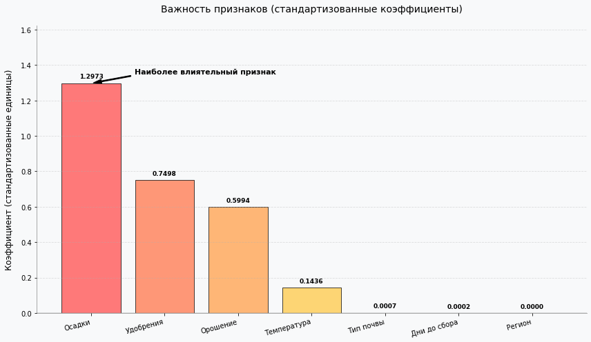
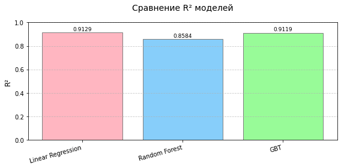
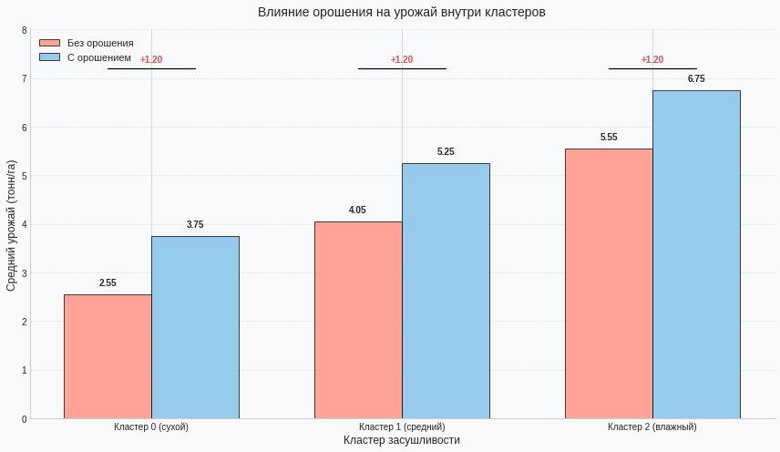

# Анализ факторов урожайности сельскохозяйственных культур

Командный учебный проект курса «Большие данные» Samsung Innovation Campus, 2024–2025. Защита состоялась 25 июня 2025 года; оценка — 9,47. Курс завершён с отличием.

**Участники:** Александр Спожакин и Арсений Кудинов. Репозиторий содержит материалы совместного проекта и не разделяет индивидуальный вклад участников.

Проект посвящён анализу связи осадков, температуры, применения удобрений и орошения с урожайностью на учебном наборе данных.

## Этапы работы

1. **Apache Pig:** загрузка CSV, удаление заголовка, преобразование типов, фильтрация пропущенных и отрицательных значений, сохранение подготовленных данных.
2. **Apache Hive:** описание внешней таблицы, группировка и агрегирование данных, расчёт корреляций и подготовка таблицы признаков.
3. **PySpark / Spark MLlib:** подготовка признаков, сравнение линейной регрессии, Random Forest и GBT; кластеризация записей по осадкам методом K-Means.
4. **Matplotlib:** визуализация коэффициентов модели, метрик и средней урожайности внутри кластеров.

Кластеризация в приложенном коде использует количество осадков; это не кластеризация регионов по совокупности климатических и почвенных характеристик.

## Файлы

- `scripts/clean_crop_yield.pig` — подготовка данных.
- `scripts/analysis.hql` — запросы Hive. Перед публикацией исправлены опечатки в `weather_condition` и `avg_yield`, добавлена отсутствовавшая точка с запятой.
- `notebooks/Spark.ipynb` — оригинальный ноутбук с кодом и сохранёнными результатами.
- `images/` — графики, извлечённые из сохранённых результатов ноутбука.

## Сохранённые результаты

Метрики на тестовой выборке из ноутбука:

| Модель | RMSE | R² |
|---|---:|---:|
| Линейная регрессия | 0,5008 | 0,9129 |
| Random Forest | 0,6385 | 0,8584 |
| GBT | 0,5037 | 0,9119 |

Разбиение данных в коде: 80% для обучения и 20% для проверки, `seed=42`. Для кластеризации по осадкам использованы три кластера; сохранённый silhouette score — 0,7523.







Эти результаты относятся к учебному набору данных. Наблюдаемые связи не доказывают причинное влияние факторов и не подтверждают качество прогноза на других данных.

## Среда и воспроизведение

Исходный CSV и конфигурация учебного кластера не входят в архив проекта. Для повторного выполнения требуются совместимые Hadoop/HDFS, Pig, Hive и Spark с PySpark, доступ к данным и Matplotlib.

Скрипт Pig ожидает CSV с заголовком и полями в следующем порядке:

```text
Region,Soil_Type,Crop,Rainfall_mm,Temperature_Celsius,Fertilizer_Used,Irrigation_Used,Weather_Condition,Days_to_Harvest,Yield_tons_per_hectare
```

Значения `Fertilizer_Used` и `Irrigation_Used` обрабатываются как строки `True`/`False`. В скрипте указан путь `/user/student/project/crop_yield.csv`; для своей среды его необходимо изменить. После подготовки данных нужно выполнить запросы Hive и анализ в Spark с доступом к таблице `crop_yield_features`.

Ноутбук сохранён из учебной сессии и не является готовым автономным приложением: начальная ячейка использует существующий объект `spark`, а последняя графическая ячейка — переменные `clusters`, `avg_rainfall`, `avg_yield` и `irrigation_data`, определения которых в архиве не сохранились. Результаты этой ячейки доступны в её выводах и в папке `images/`.

При подготовке репозитория вычисления повторно не запускались. Зависимости и состояние исходной среды полностью не восстановлены.
